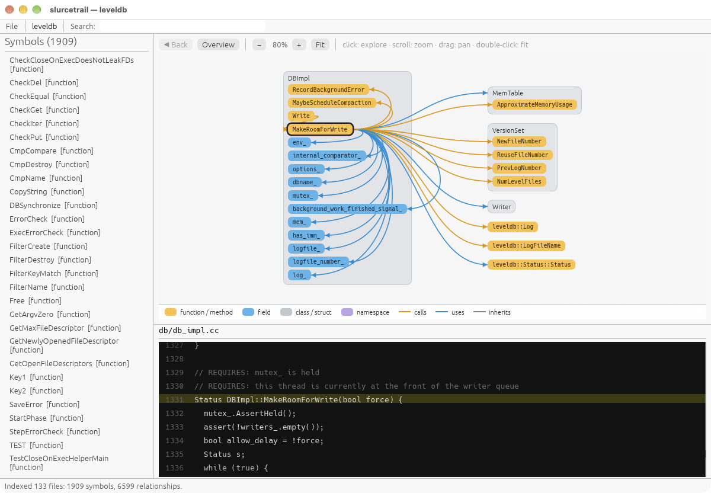
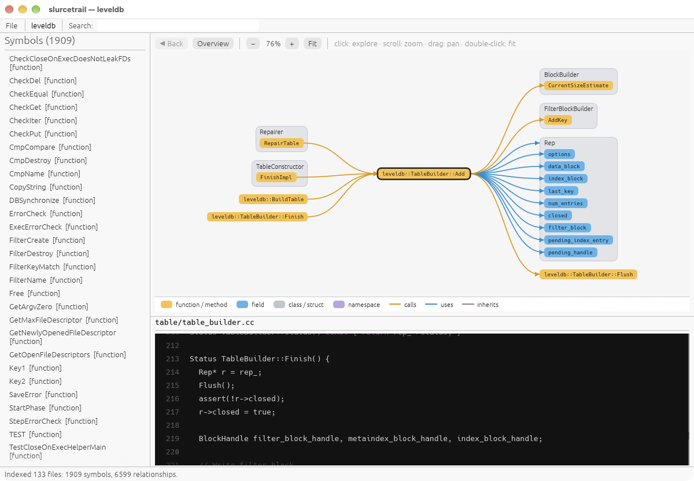
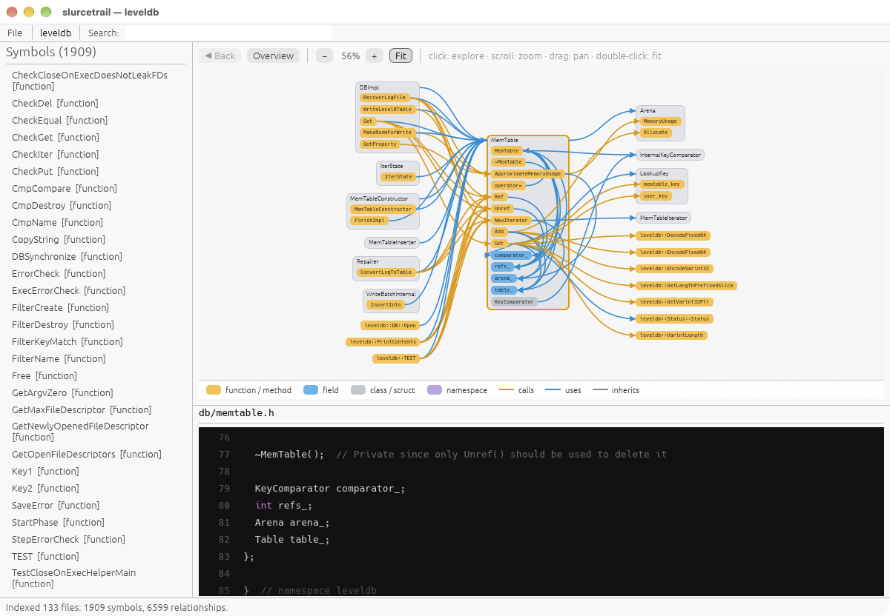

# slurcetrail

A fast, native **C/C++ source explorer** in the spirit of [Sourcetrail](https://github.com/CoatiSoftware/Sourcetrail), written in Rust with [egui](https://github.com/emilk/egui) and [tree-sitter](https://tree-sitter.github.io/).

Point it at a project folder and it indexes every C/C++ file, then lets you explore classes, functions, and fields as an interactive graph next to the source. Callers are on the left, the symbol you're looking at is in the middle, and what it uses is on the right.



*Exploring `DBImpl::MakeRoomForWrite` in [LevelDB](https://github.com/google/leveldb). Its sibling members it touches are wired inside the `DBImpl` box, and the methods it calls on `VersionSet` and `MemTable` sit on the right.*

---

## Features

### Indexing
- **Open any folder** with *File → Open Project…* (⌘O / Ctrl+O), or pass it on the command line.
- **Fast:** LevelDB indexes in about 0.1 s (133 files, 1,909 symbols, 6,599 relationships).
- **Background indexing** with a progress bar and **Cancel**, so the UI never freezes. **Re-index** at any time.
- **Respects `.gitignore`** and skips hidden folders, `node_modules`, and `target`.
- **Tolerant of real-world code:** broken syntax, non-UTF-8 files, huge or minified files (oversized ones are skipped with a warning), and deeply nested expressions are all handled without crashing.
- **Indexes** namespaces, classes, structs (including C `typedef struct {…} Name;`), functions, methods, and fields.
- **Finds** *calls*, *inheritance*, *uses* (types and members), and *containment*, and records the exact line and column of each one. Name resolution follows enclosing scopes, base classes, and local variable types, so `Circle c; c.area()` links to `Circle::area`.

### Graph
- **Sourcetrail-style trail:** callers left, active symbol center, callees and used symbols right.
- **Members live inside their class box.** Only the members involved in the relationship are shown, so the picture stays small.
- **Colored pills by kind** (function, field, class, namespace) and **curved wires by relationship** (calls, uses, inherits).
- **Click anything to explore it**, with **◀ Back** history. Hover a symbol to highlight its wires.
- Pan, zoom (scroll or pinch), and auto-fit. Large hubs are capped with a "+N more" count instead of turning into a hairball.
- A **per-file overview** shows when nothing is selected, and the canvas follows the light/dark theme.

### Source and navigation
- **Clickable source:** every name the indexer resolved is underlined in the code view. Click it to explore that symbol, or hover it to see what it is.
- **Every location, one click apart:** the code panel lists every place the selected symbol is declared or used (**◀ 3 / 11 ▶**) and names the function each use is in (*call in `DBImpl::Write`*). Click that name to explore it.
- **Code view** with syntax highlighting that highlights the selected symbol everywhere it appears in the file, and stays smooth on large files.
- **Searchable symbol list** with case-insensitive substring filtering, which stays fast with thousands of symbols.

<table>
  <tr>
    <td></td>
    <td></td>
  </tr>
  <tr>
    <td align="center"><b>Function trail:</b> <code>TableBuilder::Add</code>, its callers, and the <code>Rep</code> fields it writes</td>
    <td align="center"><b>Class view:</b> <code>MemTable</code> with all its members, who uses it, and what it depends on</td>
  </tr>
</table>

---

## Getting started

**Requirements:** a recent Rust toolchain (**1.95+**, required by eframe 0.37). Development and testing happen on macOS. egui/eframe also targets Linux and Windows, but those platforms haven't been tested yet.

```sh
git clone https://github.com/jdefrancesco/slurcetrail.git
cd slurcetrail
cargo run --release                        # starts with a small built-in demo
cargo run --release -- ~/code/myproject    # index a project on startup
```

### Command line

```
slurcetrail [PROJECT_DIR] [--symbol QUALIFIED_NAME]
```

| Option | Meaning |
|---|---|
| `PROJECT_DIR` | Folder to index on startup. |
| `--symbol NAME` | Focus a symbol once indexing finishes, either by qualified name (`leveldb::DBImpl::Write`) or by a short name if only one symbol has it. |

### Controls

| Action | How |
|---|---|
| Explore a symbol | Click it in the graph, the symbol list, or the source |
| Step through a symbol's locations | **◀ / ▶** above the code |
| Go back | **◀ Back** |
| See all files | **Overview** |
| Zoom | Scroll or pinch over the graph, or the **− / +** buttons |
| Pan | Drag the background |
| Frame everything | **Fit**, or double-click the background |
| Filter symbols | Type in **Search** |

---

## How it works

```
discover ──▶ extract ──▶ resolve ──▶ CodeGraph ──▶ trail / overview layout ──▶ render
 (ignore)   (tree-sitter)  (names → edges)         (columns, class boxes)      (egui)
```

| Module | Role |
|---|---|
| `src/index/discover.rs` | Walks the project (gitignore-aware), keeps C/C++ extensions, enforces limits |
| `src/index/extract.rs` | tree-sitter pass: declarations and unresolved references, per file |
| `src/index/resolve.rs` | Merges declarations across files and resolves names to typed edges |
| `src/index/job.rs` | Background indexing thread with progress, cancellation, and crash containment |
| `src/graph/trail.rs` | Three-column, Sourcetrail-style layout around the active symbol |
| `src/graph/overview.rs` | Per-file overview grid |
| `src/graph/render.rs` | Pills, class boxes, bezier wires, legend, theming |
| `src/code_view/` | Virtualized source view with clickable, highlighted names |
| `src/app/code_panel.rs` | Location stepping (◀ i / N ▶) for the selected symbol |

## Limitations

slurcetrail uses **tree-sitter, which is syntax-only**, so name resolution relies on heuristics rather than a compiler:

- Overloads of the same name merge into one symbol.
- `static` functions with the same name in different `.c` files currently merge too.
- Global variables, enums, and `typedef`/`using` aliases aren't indexed yet.
- `using namespace` isn't followed, and macros aren't expanded.
- An ambiguous name (for example, `x.size()` with an unknown `x` and several `size` methods) is left unlinked rather than guessed.

## Development

```sh
cargo test                                   # unit + integration tests
cargo clippy --all-targets -- -D warnings    # lints
cargo fmt

# Print the tree-sitter syntax tree of a file
cargo run --example dump_tree -- path/to/file.cpp

# Index any project headlessly and print timing and stats
SLURCETRAIL_INDEX_PATH=~/code/myproject \
  cargo test --release index_real_project -- --ignored --nocapture
```

## Acknowledgements

- Inspired by [Sourcetrail](https://github.com/CoatiSoftware/Sourcetrail) by Coati Software, now archived. slurcetrail is an independent implementation and shares no code with it.
- Screenshots show [LevelDB](https://github.com/google/leveldb) (BSD-3-Clause, © The LevelDB Authors).
- Built on [egui/eframe](https://github.com/emilk/egui), [tree-sitter](https://github.com/tree-sitter/tree-sitter) with [tree-sitter-cpp](https://github.com/tree-sitter/tree-sitter-cpp), [ignore](https://github.com/BurntSushi/ripgrep/tree/master/crates/ignore), and [rfd](https://github.com/PolyMeilleur/rfd).

## License

[MIT](LICENSE) © 2026 Joseph DeFrancesco
