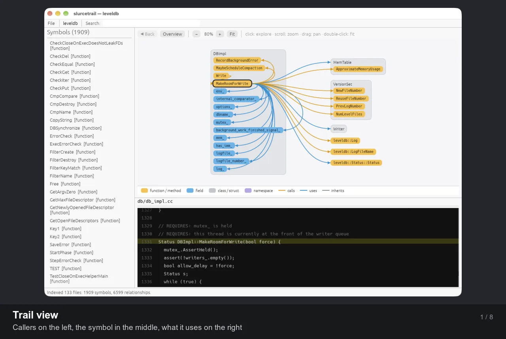

# SrcWranglr

A fast, native **C/C++ source explorer** in the spirit of [Sourcetrail](https://github.com/CoatiSoftware/Sourcetrail), written in Rust with [egui](https://github.com/emilk/egui) and [tree-sitter](https://tree-sitter.github.io/).

Point it at a project folder and it indexes every C/C++ file, then lets you explore classes, functions, and fields as an interactive graph next to the source. Callers are on the left, the symbol you're looking at is in the middle, and what it uses is on the right.



*A quick tour: the trail and class views, linked source with notes, Open in Editor, findings, Project Triage, IPC & capabilities, and fuzz targets. (`docs/screenshots/make-slideshow.sh` rebuilds it from the screenshots.)*

---

## Features

### Indexing
- **Open any folder** with *File → Open Project…* (⌘O / Ctrl+O), or pass it on the command line.
- **Fast:** LevelDB indexes in about 0.1 s (133 files, 1,909 symbols, 6,599 relationships).
- **Background indexing** with a progress bar and **Cancel**, so the UI never freezes. **Re-index** at any time.
- **Respects `.gitignore`** and skips hidden folders, `node_modules`, and `target`.
- **Tolerant of real-world code:** broken syntax, non-UTF-8 files, huge or minified files (oversized ones are skipped with a warning), and deeply nested expressions are all handled without crashing.
- **Indexes** namespaces, classes, structs (including C `typedef struct {…} Name;`), functions, methods, and fields.
- **Finds** *calls*, *inheritance*, *uses* (types and members), and *containment*, and records the exact line and column of each one. Name resolution follows enclosing scopes, base classes, and local variable types, so `Circle c; c.area()` links to `Circle::area`.

### Graph

- **Sourcetrail-style trail:** callers left, active symbol center, callees and used symbols right.
- **Members live inside their class box.** Only the members involved in the relationship are shown, so the picture stays small.
- **Colored pills by kind** (function, field, class, namespace) and **curved wires by relationship** (calls, uses, inherits).
- **Click anything to explore it**, with **◀ Back** history. Hover a symbol to highlight its wires.
- Pan, zoom (scroll or pinch), and auto-fit. Large hubs are capped with a "+N more" count instead of turning into a hairball.
- A **per-file overview** shows when nothing is selected, and the canvas follows the light/dark theme.

### Call hierarchy

- **See how control flowOs through the program:** switch the graph to **Call hierarchy** and it draws who-calls-whom as a tree, from the program's entry points (`main`, and other functions nothing calls) or from any function you pick.
- **Callees are listed in the order they are called**, top to bottom, so a function reads like its body.
- **Stays readable:** each function appears once, so tree wires never cross. Extra calls (a second caller, a call back up the tree) appear when you hover a function. Recursion is marked **↺**, and **+N** shows how many callees are left out.
- **Click any function** to re-root the tree there; **Entry points** goes back to the overview.

### Project triage

A first look at an unfamiliar codebase. Open it with **Triage → Project Triage…** (⌘⇧T / Ctrl+Shift+T) or `--triage`. It never runs git or anything else in the project, and never follows symlinks. It has seven tabs:

- **Overview:** size, lines of code, language mix, target platforms (from platform headers and `#if` checks), build systems, docs, license, CI, git branch, repository links, the best fuzz targets, and how many functions and risky calls outside input reaches.
- **Languages & Size:** files plus code, comment and blank lines for each language.
- **Repository Links:** git remotes and submodules, plus GitHub/GitLab links found in the README and build files. Nothing is fetched.
- **Binaries & Hardening:** every ELF, PE and Mach-O file in the folder, including git-ignored build directories. For each one:
  - format, architecture, size, and whether it's stripped;
  - exploit mitigations: ASLR/PIE, NX/DEP, RELRO, stack canary, FORTIFY, CFG, SafeSEH, /GS and code signing;
  - linked libraries, and the IPC its imports point to.
- **IPC & Capabilities:** library calls grouped by mechanism: pipes, Unix, netlink and network sockets (told apart by `socket()`'s arguments), shared memory, message queues, signals, D-Bus, Mach/XPC, COM, RPC/ALPC and ioctl. Process creation and dynamic loading are grouped too. Click a call to jump to it.
- **Function Complexity:** the cyclomatic complexity of every function, most complex first, with a filter. Click a function to open it.
- **Fuzz Targets:** functions worth fuzzing, best first, each with an ease rating (easy, moderate, hard). Hover a row to see what every point is for.
  - Worth comes from:
    - a name that says it takes input apart (`parse`, `decode`, `inflate`, …);
    - risky calls and tool findings inside it;
    - high complexity;
    - outside input reaching it (see **Findings** below).
  - Ease favors a buffer and its length (or a string). These cost ease: values built by hand, needing an object, being `static`, and taking a file name instead of content.
  - Code under `examples/` or `tests/` counts for less, and error and logging helpers are left out.
  - **Harness…** drafts a libFuzzer harness (`LLVMFuzzerTestOneInput` with `FuzzedDataProvider`; AFL++ builds it too) in a window where you can edit it, copy it, or save it somewhere you choose. Nothing is written unless you pick a path.
    - Lengths are set from their buffer's size, even in/out lengths passed by pointer, as in zlib's `uncompress`.
    - Anything it can't work out becomes a `TODO`.
    - Names, types and paths from the source are checked before they go into the code.

### Findings

**Analyze → Findings** (⌘⇧R / Ctrl+Shift+R) lists risky calls, most severe first. The calls are judged by their arguments, so a constant-size `memcpy` isn't flagged but `sprintf` with a non-literal format is. The list also includes results from semgrep and cppcheck, and the functions on your dangerous-functions list. Filter by severity or text, and record a verdict on each one.

**Input reachability** marks the findings that outside input may get to:
- Input comes in at calls such as `recv`, `read`, `fread`, `fgets`, `getline`, `getenv`, `scanf`, `ReadFile` and `SSL_read`, and through `main`'s command line.
- From the function that reads it, only the calls passed what was read count: the buffer filled, the variable assigned, `argv`. Below that, every call counts.
- A risky call in the reading function itself counts only if the flagged call (with its arguments, even across lines) uses what was read.
- Names inside strings and comments don't count.

Reachable findings get an **input** tag; hover it for the path, such as `recv() in serve » handle_packet » parse_header`. **Only what input can reach** filters the list to them. A finding's explanation window shows the path too, and Project Triage's Overview sums it up.

This is a prioritizer, not proof:
- Only direct calls are followed, not function pointers, callbacks or virtual calls the indexer can't resolve.
- Below the first call, everything a function calls counts, whether or not it is passed the input.
- The "passed what was read" check matches names, so input copied into another variable or a global first isn't followed.
- Same-named functions in different files are one symbol to the indexer (see **Limitations**), so one can lend reach to another.
- A finding without the tag isn't proven unreachable.

### Quick open

- **⌘P / Ctrl+P:** jump to any symbol by fuzzy name (`dbimplwr` finds `DBImpl::Write`).
- **⌘⇧P / Ctrl+Shift+P**, or type `>`: run a command (open, re-index, switch views, back, fit…).

### Source and navigation

- **Clickable source:** every name the indexer resolved is underlined in the code view. Click it to explore that symbol, or hover it to see what it is.
- **Every location, one click apart:** the code panel lists every place the selected symbol is declared or used (**◀ 3 / 11 ▶**) and names the function each use is in (*call in `DBImpl::Write`*). Click that name to explore it.
- **Code view** with syntax highlighting that highlights the selected symbol everywhere it appears in the file, and stays smooth on large files.
- **Searchable symbol list** with case-insensitive substring filtering, which stays fast with thousands of symbols.

<table>
  <tr>
    <td></td>
    <td></td>
  </tr>
  <tr>
    <td align="center"><b>Function trail:</b> <code>TableBuilder::Add</code>, its callers, and the <code>Rep</code> fields it writes</td>
    <td align="center"><b>Class view:</b> <code>MemTable</code> with all its members, who uses it, and what it depends on</td>
  </tr>
</table>

---

## Getting started

**Requirements:** a recent Rust toolchain (**1.95+**, required by eframe 0.37). Development and testing happen on macOS. egui/eframe also targets Linux and Windows, but those platforms haven't been tested yet.

```sh
git clone https://github.com/jdefrancesco/SrcWranglr.git
cd SrcWranglr
cargo run --release                        # opens on the start page
cargo run --release -- ~/code/myproject    # index a project on startup
```

The start page opens a project folder (⌘O), reopens one of your recent projects, or shows a small built-in demo. **File → Open Recent** and **File → Open Demo Project** do the same once a project is open.

### Building a package

`make package` builds the release binary and packages it for the platform you run it on. The result lands in `dist/`:

| Platform | You get | Install |
|---|---|---|
| macOS | `SrcWranglr.app` (with its icon, ad-hoc signed) and `SrcWranglr-<version>-macos-<arch>.dmg` | `make install` copies the app to `/Applications` |
| Linux | `srcwranglr-<version>-linux-<arch>.tar.gz` with the binary, a `.desktop` file and icons | `make install` (`PREFIX=/usr/local` by default; honors `DESTDIR`) |
| Windows | `srcwranglr-<version>-windows-<arch>.zip`; run `make` from Git Bash or MSYS2 | Unzip anywhere |

Other targets: `make app` (only the macOS bundle), `make check` (format, clippy, tests), `make uninstall`, and `make clean`. To sign the app with your Developer ID, run `make app SIGN_IDENTITY="Developer ID Application: …"`. The icon's source is `assets/icon.svg`. `make icons` re-renders the PNGs from it and needs `rsvg-convert`.

### Command line

```
srcwranglr [PROJECT_DIR] [--symbol QUALIFIED_NAME] [--view trail|calls] [--triage]
```

| Option | Meaning |
|---|---|
| `PROJECT_DIR` | Folder to index on startup. |
| `--symbol NAME` | Focus a symbol once indexing finishes, either by qualified name (`leveldb::DBImpl::Write`) or by a short name if only one symbol has it. |
| `--view calls` | Start in the call hierarchy instead of the trail view. |
| `--triage` | Open the Project Triage window once the project is loaded. |

### Controls

| Action | How |
|---|---|
| Jump to a symbol | **⌘P / Ctrl+P**, type part of its name, Enter |
| Run a command | **⌘⇧P / Ctrl+Shift+P** (or type `>` in the palette) |
| Switch graph view | **Trail** / **Call hierarchy** in the graph toolbar |
| Explore a symbol | Click it in the graph, the symbol list, or the source |
| Step through a symbol's locations | **◀ / ▶** above the code |
| Go back | **◀ Back** |
| See all files | **Overview** |
| Zoom | Scroll or pinch over the graph, or the **− / +** buttons |
| Pan | Drag the background |
| Frame everything | **Fit**, or double-click the background |
| Filter symbols | Type in **Search** |
| Size up the project | **⌘⇧T / Ctrl+Shift+T**, or the **Triage** menu |
| Put the source beside the graph, or back below it | **⌘⇧L / Ctrl+Shift+L**, or **View → Source Beside / Below the Graph** |
| Undo dragged pane sizes | **View → Reset Layout** |

The window opens maximized the first time. After that it reopens with the size, position and pane sizes you left it at, and with the source pane where you put it.

---

## How it works

```
discover ──▶ extract ──▶ resolve ──▶ CodeGraph ──▶ trail / overview layout ──▶ render
 (ignore)   (tree-sitter)  (names → edges)         (columns, class boxes)      (egui)
```

| Module | Role |
|---|---|
| `src/index/discover.rs` | Walks the project (gitignore-aware), keeps C/C++ extensions, enforces limits |
| `src/index/extract.rs` | tree-sitter pass: declarations and unresolved references, per file |
| `src/index/resolve.rs` | Merges declarations across files and resolves names to typed edges |
| `src/index/signature.rs` | Each function definition's prototype and parameters, for fuzz harnesses |
| `src/analysis/fuzz/` | Fuzz target scoring (`worth.rs`, `params.rs`) and libFuzzer harness drafting (`harness/`) |
| `src/analysis/reach/` | Which functions and findings outside input reaches, and by what call path |
| `src/index/job.rs` | Background indexing thread with progress, cancellation, and crash containment |
| `src/graph/trail.rs` | Three-column, Sourcetrail-style layout around the active symbol |
| `src/graph/overview.rs` | Per-file overview grid |
| `src/graph/hierarchy/` | Call hierarchy: call order, entry points, spanning tree, tree layout |
| `src/app/palette/` | Quick-open palette (fuzzy search via `nucleo-matcher`) |
| `src/graph/render.rs` | Pills, class boxes, bezier wires, legend, theming |
| `src/code_view/` | Virtualized source view with clickable, highlighted names |
| `src/app/code_panel.rs` | Location stepping (◀ i / N ▶) for the selected symbol |

## Limitations

SrcWranglr uses **tree-sitter, which is syntax-only**, so name resolution relies on heuristics rather than a compiler:

- Overloads of the same name merge into one symbol.
- `static` functions with the same name in different `.c` files currently merge too.
- Global variables, enums, and `typedef`/`using` aliases aren't indexed yet.
- `using namespace` isn't followed, and macros aren't expanded.
- An ambiguous name (for example, `x.size()` with an unknown `x` and several `size` methods) is left unlinked rather than guessed.
- Fuzz harness drafts can't see through macros. For example, zlib's `#define local static` hides that a function is static, and a header that needs another one included first still does. Such a draft needs a fix before it compiles.

## Development

```sh
cargo test                                   # unit + integration tests
cargo clippy --all-targets -- -D warnings    # lints
cargo fmt

# Print the tree-sitter syntax tree of a file
cargo run --example dump_tree -- path/to/file.cpp

# Index any project headlessly and print timing, stats and the best fuzz targets
SRCWRANGLR_INDEX_PATH=~/code/myproject \
  cargo test --release index_real_project -- --ignored --nocapture

# ...and also write those targets' harnesses to a folder
SRCWRANGLR_INDEX_PATH=~/code/myproject SRCWRANGLR_HARNESS_OUT=/tmp/harnesses \
  cargo test --release index_real_project -- --ignored --nocapture
```

## New Features Coming 

Namely they are **Security Code Auditing** capabilities:

1. Taint flow analysis. Input reachability (see **Findings**) is a first step: call paths, not data flow through variables.
2. Semantic code indexing and searches
3. Collect a solid corpus for fuzz targets (finding the targets and drafting their harnesses is done: see **Fuzz Targets** above)
4. Lightweight LM agency to help make sense of a large codebase.

Until v0.2.0 this project was called *slurcetrail*, a working title that sat too close to *Sourcetrail*. It is now **SrcWranglr**.

## Acknowledgements

- Inspired by [Sourcetrail](https://github.com/CoatiSoftware/Sourcetrail) by Coati Software, now archived. SrcWranglr is an independent implementation and shares no code with it.
- Screenshots show [LevelDB](https://github.com/google/leveldb) (BSD-3-Clause, © The LevelDB Authors).
- Built on [egui/eframe](https://github.com/emilk/egui), [tree-sitter](https://github.com/tree-sitter/tree-sitter) with [tree-sitter-cpp](https://github.com/tree-sitter/tree-sitter-cpp), [ignore](https://github.com/BurntSushi/ripgrep/tree/master/crates/ignore), [rfd](https://github.com/PolyMeilleur/rfd), and [nucleo-matcher](https://github.com/helix-editor/nucleo).

## License

[MIT](LICENSE) © 2026 Joseph DeFrancesco

## AI Augmentation

Been working on this code for a long time in order to learn Rust. 
Clankers were utilized nostky for help with the GUI and tests or ither yak-shaving
tasks that suck the soul out of me. The core is all hand
cradted code. What fun or feeling of accomplishment
would exist if I watchd an agent write the tool. I am an engineer
not a CEO; so I dont claim credit for work I didnt do.
AI sucked the magic out of coding sadly ubless we actively choose to
not utilize it!
