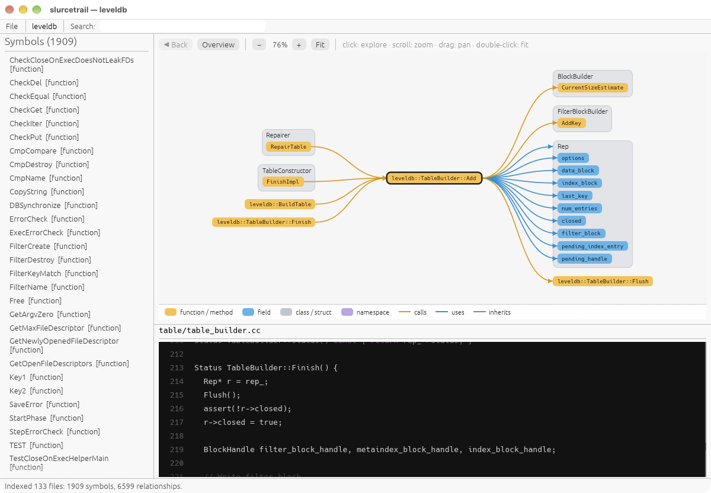
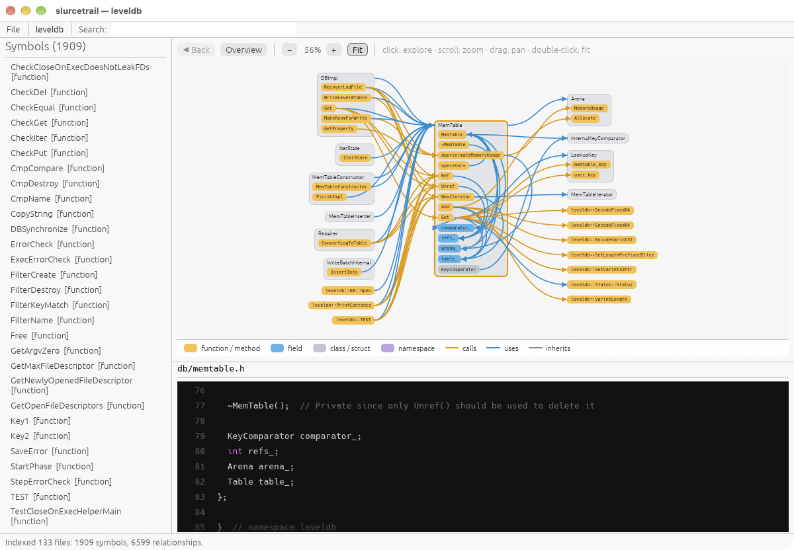

# User guide

Detailed feature behavior, controls, configuration, and development reference for SrcWranglr. For an overview and a quick start, see the [README](../README.md).

- [Navigation and graphs](#graph)
- [Project triage](#project-triage)
- [Findings and input reachability](#findings)
- [Value tracing](#tracing-a-value)
- [Related code and behavior matching](#matching)
- [Sharing an audit](#sharing-an-audit)
- [Settings](#settings)
- [Command line](#command-line)
- [Controls](#controls)
- [Architecture](#how-it-works)
- [Limitations](#limitations)
- [Development](#development)

## Indexing

- **Open any folder** with *File → Open Project…* (⌘O / Ctrl+O), or pass it on the command line.
- **Example timing:** LevelDB indexed in about 0.1 s (133 files, 1,909 symbols, 6,599 relationships). Timing varies by machine and project.
- **Background indexing** with a progress bar and **Cancel**, keeping parsing work off the UI thread. **Re-index** at any time.
- **Respects `.gitignore`** and skips hidden folders, `node_modules`, and `target`.
- **Tolerant of real-world code:** indexes incomplete syntax, reads non-UTF-8 files with replacement characters, and skips oversized files with a warning.
- **Indexes** namespaces, classes, structs (including C `typedef struct {…} Name;`), functions, methods, and fields.
- **Finds** *calls*, *inheritance*, *uses* (types and members), and *containment*, and records the exact line and column of each one. Name resolution follows enclosing scopes, base classes, and local variable types, so `Circle c; c.area()` links to `Circle::area`.

## Graph

- **Sourcetrail-style trail:** callers left, active symbol center, callees and used symbols right.
- **Members live inside their class box.** Only the members involved in the relationship are shown, so the picture stays small.
- **Colored pills by kind** (function, field, class, namespace) and **curved wires by relationship** (calls, uses, inherits).
- **Click anything to explore it**, with **◀ Back** history. Hover a symbol to highlight its wires.
- Pan, zoom (scroll or pinch), and auto-fit. Large hubs are capped with a "+N more" count instead of turning into a hairball.
- A **per-file overview** shows when nothing is selected, and the canvas follows the light/dark theme.

## Call hierarchy

- **See how calls connect through the program:** switch the graph to **Call hierarchy** and it draws who-calls-whom as a tree, from the program's entry points (`main`, and other functions nothing calls) or from any function you pick.
- **Callees are listed in source order**, top to bottom, so a function reads like its body.
- **Stays readable:** each function appears once, so tree wires never cross. Extra calls (a second caller, a call back up the tree) appear when you hover a function. Recursion is marked **↺**, and **+N** shows how many callees are left out.
- **Click any function** to re-root the tree there; **Entry points** goes back to the overview.

## Project triage

A first look at an unfamiliar codebase. Click the project's name in the menu bar (or **Triage → Show Project README**) to read its README in a window: the one at the top of the project, read without following symlinks, its Markdown laid out (headings, bold and italic text, code, lists, quotes, tables) and nothing in it fetched or run: links show their address on hover and aren't opened, images show their description, and HTML shows its text. Open the rest with **Triage → Project Triage…** (⌘⇧T / Ctrl+Shift+T) or `--triage`. It never runs git or anything else in the project, and never follows symlinks. It has seven tabs:

- **Overview:** size, lines of code, language mix, target platforms (from platform headers and `#if` checks), build systems, docs, license, CI, git branch, repository links, the best fuzz targets, and how many functions and risky calls outside input reaches.
- **Languages & Size:** files plus code, comment and blank lines for each language.
- **Repository Links:** git remotes and submodules, plus GitHub/GitLab links found in the README and build files. Nothing is fetched.
- **Binaries & Hardening:** every ELF, PE and Mach-O file in the folder, including git-ignored build directories. For each one:
  - format, architecture, size, and whether it's stripped;
  - exploit mitigations: ASLR/PIE, NX/DEP, RELRO, stack canary, FORTIFY, CFG, SafeSEH, /GS and code signing;
  - linked libraries, and the IPC its imports point to.
- **IPC & Capabilities:** library calls grouped by mechanism: pipes, Unix, netlink and network sockets (told apart by `socket()`'s arguments), shared memory, message queues, signals, D-Bus, Mach/XPC, COM, RPC/ALPC and ioctl. Process creation and dynamic loading are grouped too. Click a call to jump to it.
- **Function Complexity:** the cyclomatic complexity of every function, most complex first, with a filter. Click a function to open it.
- **Fuzz Targets:** functions worth fuzzing, best first, each with an ease rating (easy, moderate, hard). Hover a row to see what every point is for.
  - Worth comes from:
    - a name that says it takes input apart (`parse`, `decode`, `inflate`, …);
    - risky calls and tool findings inside it;
    - high complexity;
    - outside input reaching it (see **Findings** below).
  - Ease favors a buffer and its length (or a string). These cost ease: values built by hand, needing an object, being `static`, and taking a file name instead of content.
  - Code under `examples/` or `tests/` counts for less, and error and logging helpers are left out.
  - **Harness…** drafts a libFuzzer harness (`LLVMFuzzerTestOneInput` with `FuzzedDataProvider`; AFL++ builds it too) in a window where you can edit it, copy it, or save it somewhere you choose. Nothing is written unless you pick a path.
    - Lengths are set from their buffer's size, even in/out lengths passed by pointer, as in zlib's `uncompress`.
    - Anything it can't work out becomes a `TODO`.
    - Names, types and paths from the source are checked before they go into the code.

## Findings

**Analyze → Findings** (⌘⇧R / Ctrl+Shift+R) lists risky calls, most severe first. The calls are judged by their arguments, so a constant-size `memcpy` isn't flagged but `sprintf` with a non-literal format is. The list also includes results from semgrep, cppcheck and flawfinder (**Analyze → Run …**), and the functions on your dangerous-functions list. Filter by severity or text, and record a verdict on each one.

The built-in list covers about 300 functions, each with a severity, a CWE, why it's risky and what to use instead:

- **The C library and POSIX:** unbounded copies and formats, `scanf` without widths, commands and programs run, `dlopen`, predictable temp names, races on paths, `chroot`, unchecked `setuid`, weak random numbers, `atoi`.
- **Windows:** `lstrcpy`, `wsprintf` and the other unbounded string functions, `_snprintf` (which may leave no NUL), `CreateProcess` with an unquoted path, `LoadLibrary` by search path, `MultiByteToWideChar` sized in bytes, impersonation that fails silently, `IsBadReadPtr`.
- **The Linux kernel:** `copy_from_user` and `get_user` (data user space controls), the `__` forms that skip `access_ok()`, `copy_to_user` (leaks of uninitialized memory), `memdup_user`, `strncpy_from_user`, `simple_strtoul`; and `kmalloc(n * size)`, `printk` with a non-literal format, and the kernel's own `sprintf` and `strcpy`.
- **Weak crypto:** DES, 3DES, RC4, RC2, Blowfish, ECB mode, MD4, MD5 and SHA-1, DES-era `crypt()`; and certificate checks turned off (`SSL_VERIFY_NONE`, `CURLOPT_SSL_VERIFYPEER` set to 0).

A project's own definition of a library function counts too, the way the Linux kernel defines `strcpy` in `lib/string.c` and `copy_from_user` in `uaccess.h`: calls to it are judged like calls to the library's. Generic names (`access`, `random`, `warn`) and crypto names are the exceptions; a project's own `MD5_Init` or `BF_set_key` is more likely an implementation (bcrypt has one) than a misuse. A format joined to constant macros, such as `printk(KERN_INFO "…")` or `printf(PACKAGE ": %s", …)`, counts as a literal.

**Silenced warnings.** Code can tell an analyzer not to report a line with a comment: `// nosemgrep`, `/* Flawfinder: ignore */`, `// cppcheck-suppress …`, `// NOLINT`, `// coverity[…]`, `// lgtm[…]`, `// NOSONAR`, `//-V547`. SrcWranglr runs semgrep, cppcheck and flawfinder with these comments ignored, so the code you audit can't hide findings from them that way. Each such comment is also listed as a low finding from **source comments**: someone saw a warning there and silenced it. Up to 2,000 are kept per file (counted apart from TODO-style tags, so those can't crowd them out); a file with more gets a medium finding saying so.

**CodeQL and other SARIF tools.** **Analyze → Import SARIF Results (CodeQL, …)…** reads a `.sarif` report into Findings: each tool's results under its own name, with their severity (CodeQL's `security-severity`, else the level), CWE, message and place, and verdicts like any finding. SrcWranglr never builds the code or runs CodeQL itself: building a project runs its build scripts, so run `codeql database create` and `codeql database analyze --format=sarif-latest` where you trust to, then import the report. Importing again replaces that tool's earlier results. Results about files outside the project (absolute paths elsewhere, relative ones that climb out with `..`) are left out, and the status bar says how many. A report's tools may not take the names of SrcWranglr's own findings (`semgrep`, `SrcWranglr`, `git history`…), which they would replace: such a tool's results go under its name plus "(imported)". Reports up to 64 MB are read, in the background, keeping up to 200,000 results and 50 on any one line.

**Input reachability** marks the findings that outside input may get to:

- Input comes in at calls such as `recv`, `read`, `fread`, `fgets`, `getline`, `getenv`, `scanf`, `ReadFile` and `SSL_read`, and through `main`'s command line.
- From the function that reads it, only the calls passed what was read count: the buffer filled, the variable assigned, `argv`. Below that, every call counts.
- A risky call in the reading function itself counts only if the flagged call (with its arguments, even across lines) uses what was read.
- Names inside strings and comments don't count.

Reachable findings get an **input** tag; hover it for the path, such as `recv() in serve » handle_packet » parse_header`. **Only what input can reach** filters the list to them. A finding's explanation window shows the path too, and Project Triage's Overview sums it up.

This is a prioritizer, not proof:

- Only direct calls are followed, not function pointers, callbacks or virtual calls the indexer can't resolve.
- Below the first call, everything a function calls counts, whether or not it is passed the input.
- The "passed what was read" check matches names, so input copied into another variable or a global first isn't followed.
- Same-named functions in different files are one symbol to the indexer (see **Limitations**), so one can lend reach to another.
- A finding without the tag isn't proven unreachable.

## Find more like this

Right-click a line of code, then **Find More Like This…**, to hunt for variants of it. SrcWranglr drafts a semgrep rule from the call on the line (or its statement):

- **Same shape** keeps the code but for its variables: `memcpy(buf, pkt->data, ntohs(hdr->len))` becomes `memcpy($A, $B->data, ntohs($C->len))`. Called names, fields, types, literals and capitalized names (macros, constants) stay.
- **Any values** keeps only the call and its number of arguments: `memcpy($A, $B, ntohs(...))`. A string literal becomes `"..."`, and an argument with a call inside becomes `<... ntohs(...) ...>`.

A line whose names are all variables (`return len;`, `x = y;`) is refused, since its rule would match almost anything.

**Several lines.** Click a line's number to pick it, then Shift-click another to pick the lines between; right-click one of them, then **Find More Like These Lines…**. The statements on them become a sequence, with one metavariable per variable throughout, so the rule follows the same value: `p = malloc(n); … memcpy(p, src, n);` becomes `$A = malloc($B); ... memcpy($A, $C, $B);`. **Other code may come between the statements** puts `...` between them. Lines that hold exactly one statement or a whole function draft that.

**Several places.** While the window is open, right-click another line (or picked lines), then **Add Place to Rule**. The rule becomes what the places share: what is the same in all of them stays, and what differs becomes a metavariable (a string, `"..."`). `memcpy(q, k->data, k->len)` and `memcpy(out, m->data, m->len)` give `memcpy($A, $B->data, $B->len)`. Arguments only some places pass become `...`, and statements not in every place are left out. In the **Matching** pane, **Make a Semgrep Rule From These…** under a group of look-alike code does the same for the whole group.

**Exceptions** leave out matches that are fine. Right-click a line, then **Use as Rule Exception**:

- a check, such as `if (len > sizeof(buf)) return -1;`, leaves out matches after it: `if (<... $C > sizeof($A) ...>) ...` then `...`, whatever the check then does;
- a call to the same function written safely, such as `memcpy(buf, src, sizeof(buf))`, leaves out matches that look like it;
- any other statement (`len = MIN(len, sizeof(buf));`) leaves out matches after it.

An exception uses the rule's metavariables, so `len` in the check is the `$C` the rule's `memcpy($A, $B, $C)` binds. Change its kind (**Not when it is**, **Not after**, **Not inside**) or its pattern in the window, or add one by hand with **Add Exception**.

Edit the rule as you like, then **Test** runs it alone on the project and lists every match (the places you started from included). Click one to show it in the source. **Save for This Project** writes it to the project's `.srcwranglr/semgrep/`; **Save for All Projects** writes it to `~/.config/srcwranglr/semgrep/`. Before saving, semgrep checks the rule on an empty folder (nothing of the project is read); a rule it can't use is shown with semgrep's error, and **Save Anyway** saves it as it is.

Everything taken from the code (names, strings, the file's path) is written into the rule escaped, so a crafted line can't change the rule. A string literal that semgrep would read as pattern syntax (`"$HOME"`, `"..."`, `"=~/re/"`) becomes `"..."`.

## Semgrep rules

**Analyze → Run semgrep** uses three sets of rules, all from files on disk (semgrep runs offline, with no registry):

- **SrcWranglr's own:** use after free, double free, unchecked `malloc`, `realloc` leaks, returning a stack buffer, `snprintf`'s result used as a length, and `strncpy` without a NUL. They're written to `~/.config/srcwranglr/semgrep/srcwranglr-builtin.yaml` before each run, so edit a copy, not that file.
- **Yours**, for every project: any `.yaml` file in `~/.config/srcwranglr/semgrep/` (or `$XDG_CONFIG_HOME/srcwranglr/semgrep/`).
- **The project's own**, in its `.srcwranglr/semgrep/`: used only once you trust the project's files, since a hostile repository could ship rules too. Saving a rule into a project whose files are all yours marks it trusted.

`SRCWRANGLR_SEMGREP_CONFIG` replaces the first two with whatever it names.

**Analyze → Semgrep Rules…** lists all three. Pick one to read it, **Test** it on the project, edit and **Save** it, copy it to the other place, or **Delete** it. SrcWranglr's own are read-only: **Copy to Yours** makes an editable copy under a new id (the original still runs). **New Rule** starts from a template showing a pattern and two kinds of exception. A project's rules you haven't trusted are shown escaped and read-only, with **Trust This Project's Files**, and every file semgrep could load from its folder is listed, whatever its name, so you can see all of it before trusting it. Files in subfolders are listed too, read-only. Rule files are read without following a project's symlinks (a symlink is listed, not read), at most 1 MB each, 500 and 8 MB per folder; past that the window says not everything is listed. A broken rule now stops a semgrep run with semgrep's error, instead of quietly finding nothing.

**Suggested for This Project** lists the project's wrappers of risky calls: functions that pass their own parameters straight on to one. A call to `log_msg(fmt, ...)` that hands `fmt` to `vprintf` is a call to `vprintf` with the caller's format. Each wrapper gets a rule that finds the calls to it worth a look:

- its format comes from the caller: calls whose format isn't a string literal;
- its copy size comes from the caller (`memcpy`, `strncpy`): calls whose size isn't `sizeof(...)`, a number or a CAPITALIZED constant;
- its allocation size comes from the caller (`malloc`, `kmalloc`): calls whose size is a product or a sum, which can overflow;
- its arguments go to a call that is risky whatever it's passed (`strcpy`, `system`): every call.

A wrapper may check what it is passed before passing it on, so these are leads. The most called come first, with how many places call each. Pick some, then **Edit Rules for the Picked** opens their rules as a new file to test and save. Only one level is followed: a wrapper of a wrapper isn't suggested (save the first, and semgrep finds its calls). Finding them takes milliseconds (20 ms for curl), from what indexing already read.

## Tracing a value

**Trace Back** follows a value to where it comes from. It shows that `argv[1]` ends up in `strcpy(buf, name)`, and every line it passes on the way. Start a trace in either of two ways:

- **Trace Back** in a finding's window traces the arguments that make the call risky: the source and length of a copy, a format's arguments, a command, a size.
- Right-click a line in the source, then **Trace Where It Comes From** and a variable, to trace that one.

The **Trace** pane lists each way the value gets there, as a path from where it starts to where it is used. Click a step to show it in the source with the variable highlighted. A path starts at outside input (the command line, `fgets()`, `read()`, `getenv()`, `std::cin`…) or says why it stops: a constant, a global, a struct field set elsewhere, a parameter nothing calls, a function from outside the project.

```
Path 1 — from the command line
 1. main.c:10   int main(int argc, char **argv)   `argv` is the command line
 2. main.c:11   load_user(argv[1]);               passes `argv[1]` as `raw`
 3. user.c:7    char *name = trim(raw);           passes `raw` as `s`
 4. user.c:3    return s;                         `trim()` returns `s`
 5. user.c:7    char *name = trim(raw);           `name` set from `trim(raw)`
 6. user.c:8    strcpy(buf, name);                the risky call to `strcpy()`
```

What a trace follows:

- **Inside a function:**
  - Declarations, assignments, `+=` and writes into part of a variable.
  - Library calls that copy into a variable (`strcpy`, `memcpy`, `sprintf`, `sscanf`…) or read input into one.
  - An assignment that may not run (in a branch, a `for` loop's update, a `try` body, a lambda, or after a `break`, `continue` or `goto` that can skip it) keeps the earlier ones, and a parameter's value from its callers, as other paths. One that always runs hides them.
  - The other arm of an `if` doesn't count, except on a later pass of a loop.
  - A write later in a loop counts for a use earlier in it, through the next pass.
  - A variable declared in a block that has closed, or in a loop on an earlier pass, or a lambda's parameter, is another variable.
  - A declaration in a condition (`if (char *p = getenv("X"))`) has its value.
- **Across functions:**
  - A parameter goes back to each call site's argument, or says its default value is used when the call leaves it out.
  - A return value goes into the function and back out to that same call.
  - A buffer handed to a project function (`read_name(name)`) is followed into it, to what it writes there.
  - A method's result (`s.c_str()`) comes from its object.
- **Struct fields:**
  - A field is followed field by field, through the struct it is in, into functions the struct is handed to, and back to the caller's variable.
  - Writes to the struct's other fields don't count; a write to the whole struct (`s = …`, `*p = …`, `memset(p, …)`) replaces its fields.
- **Same-named functions:** a call in a file with its own definition, or to a `static` function, stays in that file.

**Trace forward** goes the other way: from a value to the risky calls it reaches. Right-click a line in the source, then **Trace Where It Goes** and a variable: `argv` in `main`, a buffer `fgets()` fills, a parameter. The **Trace** pane lists each path from there to a risky call (a finding, so your dangerous-functions list and the tools' results count too), with the argument it lands in:

```
Path 1 — reaches `strcpy()` (high)
 1. main.c:11   load_user(argv[1]);               `argv` here
 2. main.c:11   load_user(argv[1]);               `argv[1]` is passed to `load_user()` as `raw`
 3. user.c:7    char *name = trim(raw);           `raw` is passed to `trim()` as `s`
 4. user.c:3    return s;                         `trim()` returns `s`
 5. user.c:7    char *name = trim(raw);           `trim(raw)` is stored in `name`
 6. user.c:8    strcpy(buf, name);                `name` reaches `strcpy()`, argument 2
```

It follows the value through the same assignments, copies (`strcpy(dst, src)` carries it into `dst`), calls, returns (back to the call it came from, or to every caller when the trace starts inside the function), out-parameters a function writes it into, and struct fields. What is worked out from it counts too: `n = strlen(s)` carries it into `n`, and so into `memcpy(buf, s, n)`'s length. A comparison, a condition or an index uses it without passing it on. A path that stops says why: stored in a global or member, or handed to a function pointer.

Clicking a step marks every step of its path in the source, underlined in blue, so the value's way through the file shows at a glance.

**From a source to a sink** traces between two places you pick, when you already know where input arrives and which call worries you:

1. Right-click the line where the value starts, then **Set as Trace Source** and the variable (say the buffer `recv()` fills). The Trace pane shows the source until you pick a sink or **Clear** it.
2. Right-click the line of the call it might reach, then **Trace `buf` to Here** and the call. Any call counts, not only risky ones: your own `copy_field()` too.

The Trace pane lists every path from one to the other, in any argument of the call, through the same steps as a forward trace. When there is none, it shows where the value stopped being followed instead.

A path means the value *may* go that way:

- The trace reads syntax, not types.
- Writes through other pointers to the same memory aren't seen: `strm = &state->strm`, or a library filling a buffer through a pointer it was given. Neither are calls through function pointers, or checks that limit the value.
- A trace stops after a time limit, or after following many paths; it then says there may be more.

## Docs

Right-click a line, then **Show Docs** and a function called on it, or right-click a function in the **Symbols** list, then **Show Docs**:

- **A function the project defines** shows the comment documenting it, above its definition or a declaration. A header's Doxygen comment wins over a plain one at the definition. Doxygen's `@brief`, `@param` (with `[in]`/`[out]`), `@return`, `@retval`, `@note`, `@warning`, `@see` and the like are laid out under their own headings, and a plain comment is shown as its text. **Show in Source** goes to the function.
- **A library function** (`memcpy`, `recv`, `strtol`) shows this system's man page, from sections 3, 2 and 3p. Pages are read with `man` in the background, from `/` and with a time limit, and anything it starts is stopped with it; only a plain C name is looked up, and the project's own man pages are never read.

Hovering a call to a library function in the source shows the one-line summary of its man page (`memcpy – copy memory area`), and hovering a project function shows its doc comment's brief.

## Matching

The **Matching** pane (**Analyze → Semantic Code Matching**) finds code by what it is like, not by name.

**Look-alike code** lists functions, and blocks (loops, `if`s and `switch`es), that have the same shape once names, numbers, strings, comments and layout are set aside: copy-pasted parsers, vendored copies, one pattern written in several places. A fix in one copy may be missing from the others. Click **Find Look-alike Code** to read every function. This takes a moment on big projects (about a second for curl) and runs in the background. Blocks inside look-alike functions aren't listed again.

**Make a Semgrep Rule From These…**, under a group, drafts a rule from what its places share, in **Find More Like This** (see above).

**Find Code Like This Function** (right-click a line, or a function in the **Symbols** list) lists the functions shaped most like that one, likest first, with how alike they are. Exact copies show as 100%, and near copies (a check added, a line changed) lower.

**By behavior** tags each function with what the library functions it calls do: reads input, network, copies memory, copies strings, formats text, parses text or numbers, allocates, frees, runs programs, loads code, environment, changes privileges, talks to other processes, threads and locks, signals, randomness and crypto. Pick tags to list the functions that do every one of them, for example **reads input** + **copies memory**. Hover a function to see the calls behind each tag. **Count what it calls too** includes behaviors of the project functions it calls, up to three calls deep.

## Settings

**File → Settings…** (⌘, / Ctrl+,) sets four things. Each change is used and saved to `~/.config/srcwranglr/settings.toml` as you make it (typed text once you leave its field), for every project. Edit the file by hand if you like.

- **Editor:** what **Open in Editor** uses. Pick VS Code, Cursor, Zed, Sublime Text, Emacs, CLion, or Vim, Neovim or Helix in a terminal. Or write a custom command: `{file}`, `{line}` and `{column}` are filled in (`code -g {file}:{line}:{column}`). **Automatic** keeps the old behavior: `SRCWRANGLR_EDITOR`, `$VISUAL`, `$EDITOR`, then VS Code.
- **Tools:** extra folders to look for semgrep, cppcheck, flawfinder and your editor in. Each tool shows where it was found, or how to install it.
  - Tools are looked for in your folders first, then `PATH`, then the usual install places: Homebrew, `/usr/local/bin`, `~/.local/bin` (pipx), `~/Library/Python/*/bin`.
  - An app opened from the Dock or Finder gets a short `PATH` without those folders, which is why a tool can work in a terminal but not in the app. With these places searched, it usually just works.
  - Tools run with the same search as their `PATH`.
- **Source colors:** SrcWranglr Dark, Solarized Dark or Light, Monokai, Gruvbox Dark or Paper Light, with a preview.
- **Symbol list font:** Monospace (Hack, as in the source), Source Code Pro, or Iosevka, with a preview.
- **Top bar font:** the menus, the project's name and the pane toggles: Standard (Ubuntu, the toggles in Ubuntu Medium), or all in Ubuntu Medium, Source Code Pro, Iosevka or Hack, with a preview.

## Panes

The source pane sits beside the graph; **⌘⇧L / Ctrl+Shift+L** moves it below. Show or hide any pane with the buttons in the menu bar, after the project's name (**Symbols**, **Source**, **Notes**, **Findings**, **Strings**, **History**, **Matching**, **TODO**, **Trace**), or hide one with the arrow in its heading. Side panes slide in and out, and dragging one shut hides it too.

## Sessions

Reopening a project puts you back where you were:

- the selected symbol and the line the source showed,
- the graph view,
- which of the Notes, Findings and TODO panes were open,
- the last trace, run again.

**File → Save Session As…** writes the same to a `.srcwranglr-session` file, with the project's folder, to come back to later or to hand to someone. **File → Open Session…** opens one: it indexes the project if it isn't the one open, then restores the session. A session file from someone else is checked before anything in it is used: the project folder must be a full path, and files must be inside the project.

## Sharing an audit

**File → Export Audit Bundle…** writes the open project's audit to one `.srcwranglr-audit` file: where you are, your notes and bookmarks, TODOs, and finding verdicts. It names the project by its folder's name only, not a path on your machine, so a teammate can use it with their own checkout.

**File → Import Audit Bundle…** reads one into the open project. Before anything changes, it shows what merging would add, part by part, and you can leave out any part. Merging never replaces what you have:

- A note on a spot you already noted is added under yours, with where it came from. A bookmark star is added, never removed.
- TODOs already on your list aren't added again.
- On a finding you already judged, your verdict is kept. Verdicts that mark findings reviewed or false positive stop those findings being highlighted, so a bundle could hide them: they are left out unless you tick them. Confirmed-bug verdicts are merged as usual.
- Line notes follow their line's text, in case your copy of the file differs.

Importing the same bundle twice changes nothing. A bundle can come from anyone, so every part is checked the way the project's own files are, and a bad one is refused with the reason.

## Git history

When a project that is a git checkout opens, SrcWranglr reads its history in the background and looks for commits whose message says they fixed something: words like `fix`, `bug`, `revert`, `workaround`, `TODO`, and security words such as `overflow`, `use-after-free`, `oob`, `leak`, `race`, `crash`, `oss-fuzz` or a `CVE-…` id. It then traces each file those commits changed back line by line (blame), to find the lines of today's code that each fix commit last changed. Code fixed once is a good place to look for the same bug nearby, or for a fix that missed a case.

- Those lines are marked as low findings from **git history** (leads, not bugs, so they stay below what the code itself shows). They get a bar in the source's gutter and a verdict like any finding; **Lines fix commits changed** in Findings leaves them out of the list. Up to 5,000 runs of lines are marked, security fixes first.
- **History** in the menu bar (or **Analyze → Git History (fix commits)**) lists the fix commits, newest first, with how many of today's lines each still owns. Filter by text, show only security fixes, or include commits whose lines are all gone. Pick one to list its lines; click one to show it in the source.
- Its **Selected function** tab answers who last changed each line of the function you're looking at: every commit, not only fixes, newest first, with fixes picked out. Each file's history is read on demand.
- Its **CVEs** tab lists each CVE id the fix commits' messages name (`CVE-2024-1234`), with those commits and the files each changed. Click a commit to see it, and the lines it last changed, in Fix commits; click a file to open it. **NVD ↗** opens the CVE's page on nvd.nist.gov in your browser; nothing is looked up otherwise. Fixes are often committed before their CVE is assigned (the Linux kernel's mostly are), so many fixes name none: look for security words in Fix commits too.
- Only the checked-out commit's history counts. A file you changed since then isn't traced, since its lines can't be matched to commits; the pane says which.
- Up to 20,000 commits are read, 2,000 fix commits kept and 2,000 files traced, within 90 seconds. On curl's 40,000-commit history that takes about a minute in the background; zlib's takes a tenth of a second.

The repository is the audited project's, so it is never read by running `git`: a repository's own config can make `git` run programs (an fsmonitor hook, a pager, diff and textconv drivers). SrcWranglr reads it with gitoxide instead:

- In a separate worker process (SrcWranglr itself, started with `--history-worker`), which is killed at a deadline or when you open another project. A repository crafted to exhaust memory or never finish costs only that read, not the app.
- Opened without system, user or environment config and with its own config untrusted; only committed objects are read.
- `.git` must be a real folder at the project's top (not a symlink, nor a `gitdir:` file). A `.git` whose `HEAD`, `config`, `packed-refs`, `objects` or `refs` is a symlink, too large, or not what git keeps there is refused, as is one that reads from another repository's folder (`objects/info/alternates`, a linked worktree's `commondir`).
- Commit messages and author names are shown with hidden characters marked, like strings.

## TODO list

**TODO** in the menu bar (or **Go → TODO List**) opens a lightweight list for the project, saved next to its notes in `.srcwranglr/todo.json`:

- Type a TODO and press Enter. Tick it when done, double-click it to edit, and **Clear Done** to tidy up.
- Right-click a line of code, then **Add TODO Here…**, to write one about that line. Its `file:line` link takes you back there.
- **In the source** lists the `TODO`, `FIXME`, `XXX`, `HACK` and `BUG` comments in the code (and Doxygen's `\todo` and `\bug`), colored by how worrying the tag is. Filter by text or file, or show one tag. Click one to show it in the source. Tags count only in comments, in capitals, as whole words, so "a todo list" or `BUG_ON` don't. Up to 2,000 marked comments are kept per file and 100,000 in all.

## Strings

**Strings** in the menu bar (or **Analyze → Strings in the Source**) lists every string literal in the project once, with how many places write it. Filter it, sort it A–Z or by use, and pick a string to see each place: file, line and the function it is in. Click one to show it in the source.

- Strings are shown as written, except for characters that don't show as themselves: line breaks, other control characters, invisible and zero-width characters, odd spaces, and the marks that change which way text runs (bidi overrides). Those are shown as orange marks such as `‹LF›` or `‹U+202E›`, so a string can't read differently from what it holds. File and function names are shown the same way.
- Adjacent literals (`"a" "b"`) count as one string. Strings in macros count too (`#define VERSION "1.2"`, `#define LOG(x) printf("%s", x)`). `#include` paths and `extern "C"` don't count.
- Up to 5,000 strings are kept per file and 200,000 in all, each up to 512 characters. The pane says which files had more.

## Quick open

- **⌘P / Ctrl+P:** jump to any symbol by fuzzy name (`dbimplwr` finds `DBImpl::Write`).
- **⌘⇧P / Ctrl+Shift+P**, or type `>`: run a command (open, re-index, switch views, back, fit…).

## Source and navigation

- **Clickable source:** every name the indexer resolved is underlined in the code view. Click it to explore that symbol, or hover it to see what it is.
- **Every location, one click apart:** the code panel lists every place the selected symbol is declared or used (**◀ 3 / 11 ▶**) and names the function each use is in (*call in `DBImpl::Write`*). Click that name to explore it.
- **Code view** with syntax highlighting that highlights the selected symbol everywhere it appears in the file, and stays smooth on large files.
- **Searchable symbol list** with case-insensitive substring filtering, which stays fast with thousands of symbols.

<table>
  <tr>
    <td></td>
    <td></td>
  </tr>
  <tr>
    <td align="center"><b>Function trail:</b> <code>TableBuilder::Add</code>, its callers, and the <code>Rep</code> fields it writes</td>
    <td align="center"><b>Class view:</b> <code>MemTable</code> with all its members, who uses it, and what it depends on</td>
  </tr>
</table>

---

## Getting started

**Requirements:** a recent Rust toolchain (**1.95+**, required by eframe 0.37). Development and testing happen on macOS. egui/eframe also targets Linux and Windows, but those platforms haven't been tested yet.

```sh
git clone https://github.com/jdefrancesco/SrcWranglr.git
cd SrcWranglr
cargo run --release --locked               # opens on the start page
cargo run --release --locked -- ~/code/myproject    # index a project on startup
```

The start page opens a project folder (⌘O), reopens one of your recent projects, or shows a small built-in demo. **File → Open Recent** and **File → Open Demo Project** do the same once a project is open.

## Building a package

`make package` builds the release binary and packages it for the platform you run it on. The result lands in `dist/`:

| Platform | You get | Install |
|---|---|---|
| macOS | `SrcWranglr.app` (with its icon, ad-hoc signed) and `SrcWranglr-<version>-macos-<arch>.dmg` | `make install` copies the app to `/Applications` |
| Linux | `srcwranglr-<version>-linux-<arch>.tar.gz` with the binary, a `.desktop` file and icons | `make install` (`PREFIX=/usr/local` by default; honors `DESTDIR`) |
| Windows | `srcwranglr-<version>-windows-<arch>.zip`; run `make` from Git Bash or MSYS2 | Unzip anywhere |

Other targets: `make app` (only the macOS bundle), `make check` (format, clippy, tests), `make uninstall`, and `make clean`. To sign the app with your Developer ID, run `make app SIGN_IDENTITY="Developer ID Application: …"`. The icon's source is `assets/icon.svg`. `make icons` re-renders the PNGs from it and needs `rsvg-convert`.

## Command line

```
srcwranglr [PROJECT_DIR] [--symbol QUALIFIED_NAME] [--view trail|calls] [--triage]
srcwranglr --version
```

| Option | Meaning |
|---|---|
| `PROJECT_DIR` | Folder to index on startup. |
| `--symbol NAME` | Focus a symbol once indexing finishes, either by qualified name (`leveldb::DBImpl::Write`) or by a short name if only one symbol has it. |
| `--view calls` | Start in the call hierarchy instead of the trail view. |
| `--triage` | Open the Project Triage window once the project is loaded. |
| `--version`, `-V` | Print the version and quit. A build from a git checkout also names its commit, e.g. `0.4.0 (v0.4.0-5-g842efb4)` for five commits after v0.4.0. The start page and **Help → About SrcWranglr** show the same. |

## Controls

| Action | How |
|---|---|
| Jump to a symbol | **⌘P / Ctrl+P**, type part of its name, Enter |
| Run a command | **⌘⇧P / Ctrl+Shift+P** (or type `>` in the palette) |
| Switch graph view | **Trail** / **Call hierarchy** in the graph toolbar |
| Explore a symbol | Click it in the graph, the symbol list, or the source |
| Highlight a name everywhere in the file | Click it in the source (any name: a variable, a call); **Esc** or a click on space clears it |
| Cross references (every use and call), as in IDA | Point at a name in the source and press **X**, or right-click a line, then **Cross References**; **X** elsewhere, or **Go → Cross References to Selected Symbol**, for the symbol selected |
| Step through a symbol's locations | **◀ / ▶** above the code |
| Go back | **◀ Back** |
| See all files | **Overview** |
| Zoom | Scroll or pinch over the graph, or the **− / +** buttons |
| Pan | Drag the background |
| Frame everything | **Fit**, or double-click the background |
| Filter symbols | Type in **Search** |
| Size up the project | **⌘⇧T / Ctrl+Shift+T**, or the **Triage** menu |
| Read the project's README | Click the project's name in the menu bar, or **Triage → Show Project README** |
| Bring in CodeQL's (or any tool's) results | **Analyze → Import SARIF Results (CodeQL, …)…** |
| Put the source below the graph, or back beside it | **⌘⇧L / Ctrl+Shift+L**, or **View → Source Beside / Below the Graph** |
| Show or hide a pane | The buttons in the menu bar, or the arrow in a pane's heading; **⌘B / Ctrl+B** for Notes, **⌘⇧R / Ctrl+Shift+R** for Findings |
| Settings (editor, tool folders, source colors, symbol list font) | **⌘, / Ctrl+,**, or **File → Settings…** |
| Save or reopen where you were | **File → Save Session As… / Open Session…** (reopening a project restores it too) |
| TODO list | **TODO** in the menu bar, or **Go → TODO List**; right-click a line, then **Add TODO Here…** |
| Strings in the source, and where each is used | **Strings** in the menu bar, or **Analyze → Strings in the Source** |
| Trace where a value comes from | **Trace Back** in a finding's window, or right-click a line, then **Trace Where It Comes From** |
| Trace where a value goes | Right-click a line, then **Trace Where It Goes**; click a step to mark its path in the source |
| Trace from a source to a sink | Right-click a line, then **Set as Trace Source**; then right-click the call's line, then **Trace … to Here** |
| A function's docs or man page | Right-click a line, then **Show Docs**, or a function in **Symbols**; hover a library call for its summary |
| Find more code like a line, or like several | Right-click a line, then **Find More Like This…**; click line numbers (Shift-click for a range) to pick several lines first; **Add Place to Rule** and **Use as Rule Exception** while it is open |
| See, write and edit semgrep rules | **Analyze → Semgrep Rules…** |
| Look-alike code, code like a function, functions by behavior | **Matching** in the menu bar; right-click a line or a function in **Symbols**, then **Find Code Like This…** |
| Share your audit, or take in someone's | **File → Export Audit Bundle… / Import Audit Bundle…** |
| Undo dragged pane sizes | **View → Reset Layout** |

The window opens maximized the first time. After that it reopens with the size, position and pane sizes you left it at, and with the source pane where you put it.

---

## How it works

```
discover ──▶ extract ──▶ resolve ──▶ CodeGraph ──▶ trail / overview layout ──▶ render
 (ignore)   (tree-sitter)  (names → edges)         (columns, class boxes)      (egui)
```

| Module | Role |
|---|---|
| `src/index/discover.rs` | Walks the project (gitignore-aware), keeps C/C++ extensions, enforces limits |
| `src/index/extract.rs` | tree-sitter pass: declarations and unresolved references, per file |
| `src/index/resolve.rs` | Merges declarations across files and resolves names to typed edges |
| `src/index/signature.rs` | Each function definition's prototype and parameters, for fuzz harnesses |
| `src/analysis/fuzz/` | Fuzz target scoring (`worth.rs`, `params.rs`) and libFuzzer harness drafting (`harness/`) |
| `src/analysis/reach/` | Which functions and findings outside input reaches, and by what call path |
| `src/analysis/risky/`, `heuristics.rs` | The built-in risky functions (C library, Windows, Linux kernel, weak crypto) and judging a call by its arguments |
| `src/analysis/trace/` | Tracing a value back to where it comes from (`walk.rs`) or forward to the risky calls it reaches (`forward/`, `goes.rs`), across functions, by syntax |
| `src/analysis/tools.rs`, `flawfinder.rs` | Running semgrep, cppcheck and flawfinder, and reading their reports |
| `src/history/` | Reading the git history with gitoxide in a worker process (`worker.rs`): fix commits by message (`keywords.rs`), the lines each last changed (`read.rs`, `file.rs`), and findings for them |
| `src/analysis/similar/`, `src/app/similar_view.rs` | Drafting a semgrep rule from a line, several lines (`pick.rs`) or several places (`unify.rs`), with exceptions (`exception.rs`): Find More Like This |
| `src/analysis/semgrep_rule.rs`, `src/analysis/wrappers.rs` | Writing rules' YAML, escaped; the project's wrappers of risky calls and their rules |
| `src/app/rules_view.rs`, `rule_library.rs`, `rule_editor.rs`, `rule_files.rs` | The Semgrep Rules window: listing, editing, checking and saving rules |
| `src/app/xrefs.rs`, `xrefs_view.rs` | Cross references (X over a name): every reference to a symbol or call to a library function |
| `src/app/markdown.rs`, `readme.rs`, `readme_view.rs` | The README window: finding and reading the README, Markdown by pulldown-cmark, laid out |
| `src/analysis/sarif.rs`, `src/app/sarif_actions.rs` | Importing SARIF reports (CodeQL's) into Findings |
| `src/history/cves.rs`, `src/app/history_cves.rs` | The CVEs fix commits name, and the History pane's CVEs tab |
| `src/analysis/lookalike.rs`, `behavior.rs` | Look-alike code by token shape, and each function's behaviors from the calls it makes (the Matching pane) |
| `src/docs/` | A function's docs: its doc comment (`comments.rs`), read as Doxygen (`doxygen.rs`), or this system's man page (`man.rs`) |
| `src/process.rs` | Running a program with a deadline, an output cap and a stop flag (the history worker, `man`) |
| `src/app/bundle.rs` | Audit bundles: writing, checking and merging them into a project's notes, TODOs and verdicts |
| `src/index/comment_marks.rs`, `src/analysis/silenced.rs` | Comments that silence analyzers or leave TODO-style tags, and the findings for the former |
| `src/version.rs`, `build.rs` | Which version this is; `build.rs` records the git commit it was built from |
| `src/programs.rs` | Finding the programs to run: your folders, `PATH`, then the usual install places |
| `src/app/settings.rs` | Your settings file; `settings_view.rs` is the Settings window |
| `src/app/session.rs` | Sessions: what is kept per project and in session files, and checking them |
| `src/notes/todo.rs` | The project's TODO list on disk |
| `src/index/job.rs` | Background indexing thread with progress, cancellation, and crash containment |
| `src/graph/trail.rs` | Three-column, Sourcetrail-style layout around the active symbol |
| `src/graph/overview.rs` | Per-file overview grid |
| `src/graph/hierarchy/` | Call hierarchy: call order, entry points, spanning tree, tree layout |
| `src/app/palette/` | Quick-open palette (fuzzy search via `nucleo-matcher`) |
| `src/graph/render.rs` | Pills, class boxes, bezier wires, legend, theming |
| `src/code_view/` | Virtualized source view with clickable, highlighted names |
| `src/app/code_panel.rs` | Location stepping (◀ i / N ▶) for the selected symbol |

## Limitations

SrcWranglr uses **tree-sitter, which is syntax-only**, so name resolution relies on heuristics rather than a compiler:

- Overloads of the same name merge into one symbol.
- `static` functions with the same name in different `.c` files currently merge too.
- Global variables, enums, and `typedef`/`using` aliases aren't indexed yet.
- `using namespace` isn't followed, and macros aren't expanded.
- An ambiguous name (for example, `x.size()` with an unknown `x` and several `size` methods) is left unlinked rather than guessed.
- Fuzz harness drafts can't see through macros. For example, zlib's `#define local static` hides that a function is static, and a header that needs another one included first still does. Such a draft needs a fix before it compiles.

## Development

```sh
cargo test                                   # unit + integration tests
cargo clippy --all-targets -- -D warnings    # lints
cargo fmt

# Print the tree-sitter syntax tree of a file
cargo run --example dump_tree -- path/to/file.cpp

# Index any project headlessly and print timing, stats and the best fuzz targets
SRCWRANGLR_INDEX_PATH=~/code/myproject \
  cargo test --release index_real_project -- --ignored --nocapture

# ...and also write those targets' harnesses to a folder
SRCWRANGLR_INDEX_PATH=~/code/myproject SRCWRANGLR_HARNESS_OUT=/tmp/harnesses \
  cargo test --release index_real_project -- --ignored --nocapture
```
