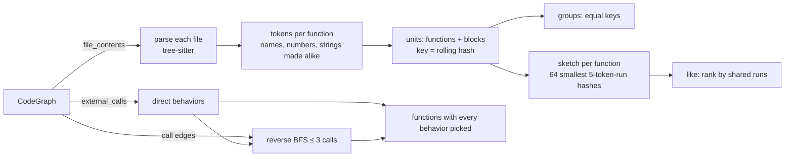
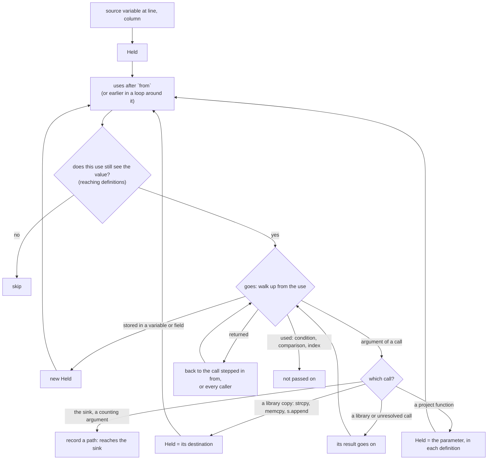

# How semantic matching and source → sink tracing work

This note covers how two features are built, for anyone changing them:

- **Semantic code matching** (the **Matching** pane):
  - look-alike code;
  - "code like this function";
  - functions found by behavior.
- **Source → sink tracing**: every path a value takes from a variable you pick to a call you pick.

Both work offline from the syntax that tree-sitter reads. Neither compiles the project, runs any of its code, or uses a language model. For how to use them, see the [user guide](guide.md#matching) and the guide's [Tracing a value](guide.md#tracing-a-value) section.

## What they start from

Indexing (`src/index/`) builds a `CodeGraph` (`src/model.rs`). Both features read these parts of it:

| Part | What it holds | Used by |
|------|---------------|---------|
| `file_contents` | Every indexed file's text | Look-alikes re-parse it; the tracer parses files as it reaches them |
| `symbols` | Functions, methods, types and fields, with file and line | Naming units; resolving calls |
| `edges` (`EdgeKind::Calls`) | Which project function calls which | Behaviors through calls; the tracer's callers |
| `external_calls` | Calls to functions the project doesn't define (`memcpy`, `recv`), with caller, span and argument text | Behavior tags; hover summaries |
| `functions` | Each function definition's file, first line and length | Placing a line inside its function |

The project's graph is shared as an `Arc<CodeGraph>` (`src/app/project.rs`), so background work can read it without copying it.

---

## Part 1: Semantic code matching

The Matching pane has two tabs that answer different questions:

- **Look-alike code**: "Where else is code shaped like this?" Copy-pastes, vendored copies, and one pattern (or one bug) written in several places.
- **By behavior**: "Which functions do these things?" For example, functions that read input *and* copy memory, however they are written.



### Look-alike code

Code: `src/analysis/lookalike.rs` and `src/analysis/lookalike/tokens.rs`.

#### Units

A **unit** is something compared as a whole:

- a **function**: every `function_definition`, at least **30 tokens** long;
- a **block**: a `for`, range-`for`, `while`, `do`, `if` or `switch` statement inside a function, at least **40 tokens** long.

The minimums keep out getters and one-liners, which look alike without meaning anything.

A unit records:
- its file and line span;
- the function it is (or is in);
- its token count;
- its **key**, which is equal for equal shapes;
- for functions, a **sketch** used for ranking;
- its **parent**: the unit it sits inside, if any.

#### Tokens: what "the same shape" means

`FunctionTokens::of` walks a function's syntax tree once, iteratively, so deep nesting can't overflow the stack. It emits one token per leaf, with these rules:

| Syntax | Token |
|--------|-------|
| `identifier`, `field_identifier`, `type_identifier`, `namespace_identifier`, `statement_identifier`, `destructor_name` | `$` |
| `number_literal` | `0` |
| string, raw string, concatenated string, char and user-defined literals | `""` (their insides are skipped) |
| `preproc_arg` | `#` |
| `comment` | nothing |
| any other leaf: keywords, operators, punctuation, primitive types | its own text (`int`, `+=`, `{`) |

So renaming variables, changing constants or strings, reformatting, and editing comments don't change a shape. Changing the logic (an extra check, a different operator, a different keyword or primitive type) does. Each token is hashed to a `u64`, and its start byte is kept.

#### Keys: one pass per function, constant time per block

A function's key is a hash of its whole token stream.

Blocks are where the cost could blow up. Hashing every nested block's tokens separately is quadratic: a long `else if` chain nests thousands deep. So each function's tokens get a **polynomial rolling hash** (mod 2⁶⁴, base `0x100000001b3`):

```
prefix[0] = 0
prefix[i+1] = prefix[i] · BASE + token[i]
hash(l..r) = prefix[r] − prefix[l] · BASE^(r−l)
key(l..r) = hash(l..r) XOR (r − l) · 0x9e3779b97f4a7c15
```

A block's tokens are found by binary search on token start bytes (`range_of`). Its key then costs O(1). Equal token runs get equal keys wherever they are, so a block can match another block in a different function or file.

#### Walking a file

`Walk::units_in` makes one iterative cursor walk over each file:

- **On entering a `function_definition`:** it tokenizes the function, creates the function unit (if long enough), and names it. The name is the indexed symbol whose name is on the line of the function's declarator. If that fails, typically because macros confuse the parser, `place_in_functions` falls back to the index's line-to-function lookup.
- **On a block kind inside a function:** it creates a block unit from the function's tokens. The block's parent is the innermost enclosing unit.
- **Caps per function:** at most **2,000** blocks, and blocks nested more than **64** deep aren't kept. Both bound the work and the length of parent chains.
- **Stopping:** the stop flag is checked every 4,096 syntax nodes, not just between files.

#### Groups

`groups()`:
1. Buckets units by `(key, is_function)`; buckets with 2 or more units are candidate groups.
2. Sorts them biggest first (token count), functions before blocks of the same size.
3. Walks them in that order. A group is **skipped** when every one of its units sits inside a unit already listed: it walks each unit's parent chain, which is at most 64 deep. So the loops of two look-alike functions aren't listed again as look-alike blocks, but a block copied into otherwise different functions is.
4. Keeps at most **500** groups, and says when more were found.

Each group's heading ("3 functions · 52 tokens — a, b, c and 2 more") is made once, in the background, and cut to 64 characters. A collapsing heading doesn't wrap, so a longer one would widen the pane.

#### Code like one function

"Find Code Like This Function" ranks *near* copies too: a check added, a line changed. It uses runs rather than whole shapes:

1. **Runs.** Every 5 consecutive tokens of a function form a run, hashed.
2. **Sketch.** The function keeps the **64 smallest** distinct run hashes (a *bottom-k* sketch).
3. **Likeness.** Two functions' likeness estimates the Jaccard index of their run sets:
   - Merge the two sorted sketches, taking the smallest values of the union, at most 64 of them.
   - Only values up to a cutoff count. The cutoff is the largest value held by any sketch that is full; past it, what a full sketch's function holds is unknown.
   - Likeness is the share of the values taken that are in both.
   - When neither function has more than 64 distinct runs, this is the exact Jaccard index. When either has more, it is the standard bottom-k estimate.
4. **Candidates** are the other functions within 2.5× the size, in tokens. An equal key scores 100%. Anything under **40%** is dropped, and the top **50** are listed.

On curl, ranking all of its functions takes under a millisecond. For `set_remote_option` it finds its twin `set_local_option` at 100%, then the other telnet option handlers at 62–78%.

#### Where it runs

All of it runs in the background, through `matching::Work<T>` (a `BackgroundJob` that the window polls):

- reading shapes;
- grouping and headings;
- the like ranking, started once the shapes are there.

| Project | Units | Read and grouped (release build) |
|---------|------:|------------------|
| zlib | 1,321 | 0.15 s |
| curl | 12,779 | 0.75 s |

Caps: 400,000 units per project; files over 4 MB are skipped. Both show as "not all of it is listed".

#### Limits

- **Syntax only.** Equal shapes are look-alikes even if their names mean different things. Reordered statements are a different shape, though ranking still scores them as near.
- **Macros** aren't expanded. Code that tree-sitter mis-parses because of a macro is compared as parsed.
- **Hashes.** Both hashes are 64-bit, so accidental collisions are negligible. The rolling hash, though, is not built to resist inputs crafted to collide. A hostile project could make two different blocks show as look-alikes. That is only a false lead on screen: nothing acts on it.
- **Session only.** Hashes use the standard library's `DefaultHasher`, which is fine within one run and never saved.

### Behavior tags

Code: `src/analysis/behavior.rs`, and the pane's state in `src/app/matching.rs`.

#### Tags from calls

A function's behaviors come from the **library functions it calls**. `behaviors_of_call(name)` maps a call's name (with a `std::` or `::` prefix stripped) to zero or more of 19 tags:

| Tag | Example calls |
|-----|---------------|
| reads input | `read`, `fread`, `fgets`, `getline`, `scanf`, `recv`, `SSL_read`, `ReadFile` |
| network | `socket`, `connect`, `accept`, `recv*`, `send*`, `getaddrinfo` |
| writes output | `write`, `fwrite`, `fputs`, `send`, `WriteFile` |
| opens or changes files | `open`, `fopen`, `stat`, `unlink`, `rename`, `mkstemp`, `CreateFileW` |
| copies memory | `memcpy`, `memmove`, `bcopy`, `CopyMemory` |
| copies strings | `strcpy`, `strncpy`, `strcat`, `strlcpy`, `strdup` |
| formats text | `sprintf`, `snprintf`, `printf`, `syslog` |
| parses text or numbers | `sscanf`, `strtol`, `atoi`, `strtok` |
| allocates / frees | `malloc`, `calloc`, `realloc`, `mmap` / `free`, `munmap` |
| runs programs | `system`, `popen`, `exec*`, `fork`, `posix_spawn`, `CreateProcessW` |
| loads code | `dlopen`, `dlsym`, `LoadLibraryW`, `GetProcAddress` |
| environment | `getenv`, `setenv`, `putenv` |
| changes privileges | `setuid`, `setresuid`, `chroot`, `capset`, `prctl` |
| talks to other processes | anything `analysis::capabilities` files under an IPC category (pipes, sockets, shared memory, message queues, D-Bus, …) |
| threads and locks | `pthread_create`, `pthread_mutex_lock`, `CreateThread` |
| signals | `signal`, `sigaction`, `kill`, `raise` |
| randomness | `rand`, `random`, `arc4random`, `getrandom`, `RAND_bytes` |
| crypto | name prefixes: `EVP_`, `SSL_CTX_`, `RSA_`, `AES_`, `SHA256`, `mbedtls_`, `wc_`, `gcry_`, `BCrypt`, … |

One call can carry several tags: `recv` both *reads input* and is *network*. Each list is a single space-separated string, so adding a name is a one-word edit.

#### Direct and through calls

- **Direct.** `direct_behaviors` walks `graph.external_calls` once. For each caller it records each tag and the calls that showed it, which the pane shows on hover.
- **Through calls** (`reached_behaviors`). For each of the 19 tags, a **reverse breadth-first search** starts from every function that has the tag directly. It walks the *called by* relation built from `EdgeKind::Calls` edges, up to **3** calls. The result per tag is the set of functions that have it themselves or within 3 calls. This costs O(19 × (functions + call edges)), and is computed once.

A query intersects these sets: the functions that have *every* tag picked, directly or through calls depending on the checkbox. The pane does the following:

- builds the tags in the background;
- caches the matched list until the tags, the checkbox or the filter change;
- lays out only the rows on screen;
- works out each row's "why" only when you hover it.

#### Limits

- Only library calls known **by name** give tags. A project's own wrapper (`my_memcpy`) gives none by itself; its callers get *copies memory* only through calls, and only if the wrapper calls `memcpy`.
- Calls through function pointers and macros that hide calls aren't seen.
- "Through calls" follows project call edges, which merge overloads and same-named statics (see the [guide's limitations](guide.md#limitations)).

---

## Part 2: Source → sink tracing

Source → sink tracing answers: *does the value in this variable reach that call, and how?* An example: does the buffer `recv()` fills reach this `memcpy`'s length, possibly by way of other functions?

### In the app

1. Right-click a line → **Set as Trace Source** → pick a variable.
   - The source is held as a `TraceSource` in the Trace pane's state (`src/app/trace_panel.rs`), shown at the top of the pane with **Clear**.
   - The source pane is told the variable's name, so its line menu can offer the next step.
2. Right-click the line of a call → **Trace `x` to Here** → pick a call on that line.
   - This makes a `TraceStart::Between { file, line, column, sink_file, sink_line, sink_call }` (`src/app/session.rs`) and runs it. Sessions save it like any other trace.
   - The source is forgotten once a trace is shown. It is kept if nothing could be traced, so it needn't be picked again.
   - Clicking a step marks its whole path in the source.

### Sinks

The forward tracer (Trace Where It Goes) already stopped at **sinks**, the risky calls behind findings. A sink (`analysis::trace::Sink`) now says which call it is and which arguments count:

| | Finding sink (`Sink::of`) | Picked sink (`Sink::picked`) |
|-|---------------------------|------------------------------|
| Where | the finding's file, line, and column when known | the line picked; any column |
| Which call | the one at that column | the call to `name` on that line (`last_name` reduces `ns::f`, `obj.f`, `p->f`, `f<int>` to `f`) |
| Arguments that count (`SinkArgs`) | `Risky`: those `risky_args` names for the function (`memcpy`'s source and length, `sprintf`'s format and values, …) | `Any` |
| Shown as | "reaches `strcpy()` (high)" | "reaches `copy_field()` (the sink)" |

`trace_between` runs the forward tracer with **only** the picked sink:
- If any path reaches it, only those paths are kept.
- If none does, the paths that stopped are kept instead, each saying why, so you can see where the value was lost.

The trace's direction is `Between`, which the Trace pane titles "Traced from a source to a sink".

### How a value is followed

Code: `src/analysis/trace/forward/` (`Follower`), plus the tracer's shared modules:

| Module | Role |
|--------|------|
| `files.rs` | parses files as reached; finds the function around a byte, a call's callee and definitions |
| `defs.rs` | the writes to a name in a function, and which reach a point (reaching definitions, by syntax) |
| `goes.rs` | where a value goes from a use, walking up the syntax |
| `flows.rs` | access paths (`s.buf.len` → base `s`, fields `buf.len`) |
| `calls.rs` | library calls: which arguments are risky (`risky_args`), and which arguments a call copies into which (`write_of`: `strcpy` copies its second argument into its first) |
| `sites.rs` | where each project function is called from |
| `scope.rs` | loops and blocks |

The value being followed is a **`Held`**:

- `file`, `name`, `field`: the variable, and which field of it (empty means all of it);
- `from`: the byte it holds the value from;
- `writes`: the writes that put the value there;
- `is_from_before`: whether it is the value the variable already had, as for a parameter;
- `returns_to`: the calls stepped into, innermost last, so a `return` goes back to the right call.



Step by step (`Follower::follow_here` and `goes_on_here`):

1. **Uses.** `uses_of` lists the uses of `name` in the function. `uses_after` keeps those after `from`, plus earlier ones inside a loop around `from` (the loop brings the value back to them), up to 64.
2. **Is the value still there?** For each use, `reaches` asks `defs::Writes::reaching` which writes reach it. The use counts if one of the held writes is among them, or if this is a value from before and no write replaces it on every path. Writes in the other arm of an `if`, to a shadowing variable, or to a different field don't count. When more writes reach the use than are kept (6), the use counts as reached: missing a path is worse than showing one too many.
3. **Where the value goes** (`goes`) walks up from the use, through what passes a value on: arithmetic, casts, `*`, `&`, and methods called on it. It ends in one of four ways:
   - **Stored** in a variable, field or element. The new place becomes the next `Held`, from the end of the write.
     - A global or member is noted as a stop: it is used elsewhere and isn't followed there.
     - A store through a pointer parameter (`*out = v`, `p->f = v`) also goes back out through the caller's argument (`out_through`).
   - **An argument** of a call (`argument`):
     - If this call is a sink and the argument counts, a path is recorded: the trail of steps so far plus this one. Following goes on past it, since the value may reach other sinks too.
     - If the call copies the argument somewhere (`strcpy(dst, src)`, `s.append(x)`), the destination is followed.
     - Otherwise, if a project function is called, the value is followed into the matching parameter of each of its definitions (up to 4), with the call pushed onto `returns_to`. The call's result is then not followed at the call: it comes back only if the callee returns the value (**Returned**, below).
     - For a library call, an unresolved one, or a project function whose parameter can't be found, whatever the call returns may be made from the value (`strlen(s)`, `strdup(s)`), so the call's result goes on.
     - A call through a function pointer is a stop.
   - **Returned:** back to the call stepped in from. When the trace started inside the function, it goes back to every caller (up to 8), and recursion is cut off.
   - **Used** without passing it on, as in a condition, a comparison or an index: the path ends there.
4. Every step adds a line to the trail ("`n` is passed to `store()` as `len`"), which becomes the path shown in the Trace pane.

### Keeping it bounded

The tracer runs on the window's thread, so it is bounded:

| Limit | Value | Why |
|-------|------:|-----|
| Time | 750 ms | the window waits for it |
| Paths to sinks | 24 | enough to see the shape of things |
| Stops kept | 8 | the reasons a value was lost |
| Values followed | 2,000 | a big call graph can't stall it |
| Steps in a path | 40 | |
| Nesting of the walk | 64 | a bounded stack |
| Calls stepped into | 8 deep | recursion ends |
| Callers / definitions per call | 8 / 4 | |
| Uses of one value | 64 | |
| Visits per variable | 3 | values that cycle between variables in a loop end |

A trace that hits a limit says so: "Limits were reached, so there may be more paths."

### An example

From `src/analysis/trace/between_tests.rs`:

```c
void store(char *dst, const char *src, int len) { }
void handle(int fd) {
    char buf[64], out[8];
    int n = read(fd, buf, sizeof buf);   // source: n
    log_it(n); store(out, buf, 0);
    store(out, buf, n);                  // sink: store
}
```

Tracing `n` to `store()` on the last line gives one path: line 5, then line 7, ending "`n` reaches `store()`, argument 3".

- The `store` call on line 6 doesn't count: it isn't on the line picked.
- Picking line 6 with `store` finds nothing, because `n` isn't in that call. Picking it with `log_it` finds the path.
- Across functions, a value passed to `middle(n)`, which calls `sink_fn(k)`, is followed into `middle`'s parameter `k` and on to the sink.

### Limits

Like every trace here, source → sink reads **syntax, not types**:

- **Aliases aren't seen:** a write through another pointer to the same memory, or a library filling a buffer through a pointer it was given. Neither are calls through function pointers.
- **Checks don't stop it.** A check that limits the value (`if (n > sizeof buf) return;`) isn't modeled, so a path means the value *may* get there.
- **Same-named calls on one line.** Two calls to the same function on the picked line both count as the sink.
- **No path isn't proof.** "No path found" means none was found within the limits above, not that none exists.

### Tests

| Area | Tests |
|------|-------|
| Picked sinks, any argument, the name filter, qualified and template names | `src/analysis/trace/between_tests.rs` |
| The forward tracer | `src/analysis/trace/forward_tests.rs` |
| Source, sink and session in the app | `src/app/trace_actions.rs`, `src/app/session.rs`, `src/app/code_panel_tests.rs` |
| Tokens, keys, likeness | `src/analysis/lookalike/tokens.rs` |
| Look-alikes: renamed copies, blocks, nesting, like ranking | `src/analysis/lookalike_tests.rs` |
| Behaviors | `src/analysis/behavior.rs`, `src/app/matching.rs` |
| The Matching pane | `src/app/matching_panel_tests.rs` |
